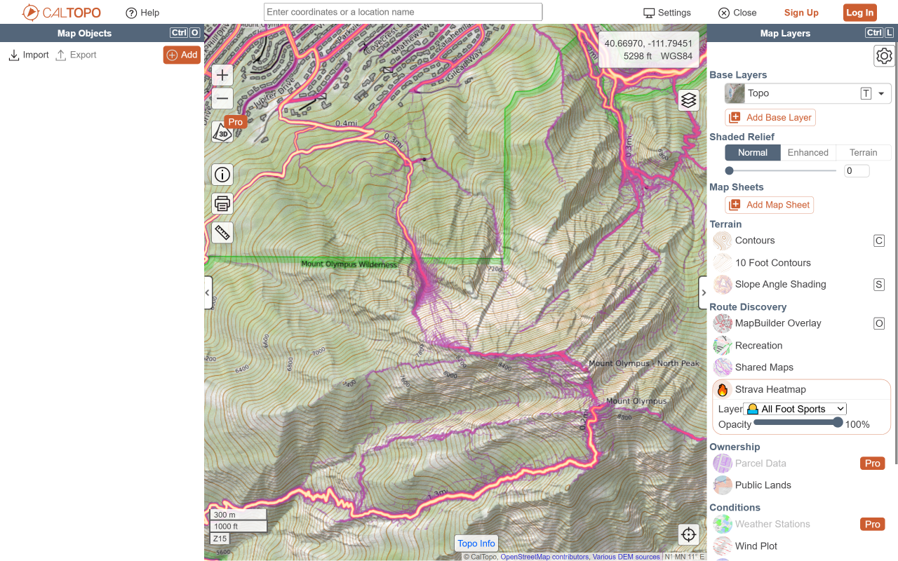
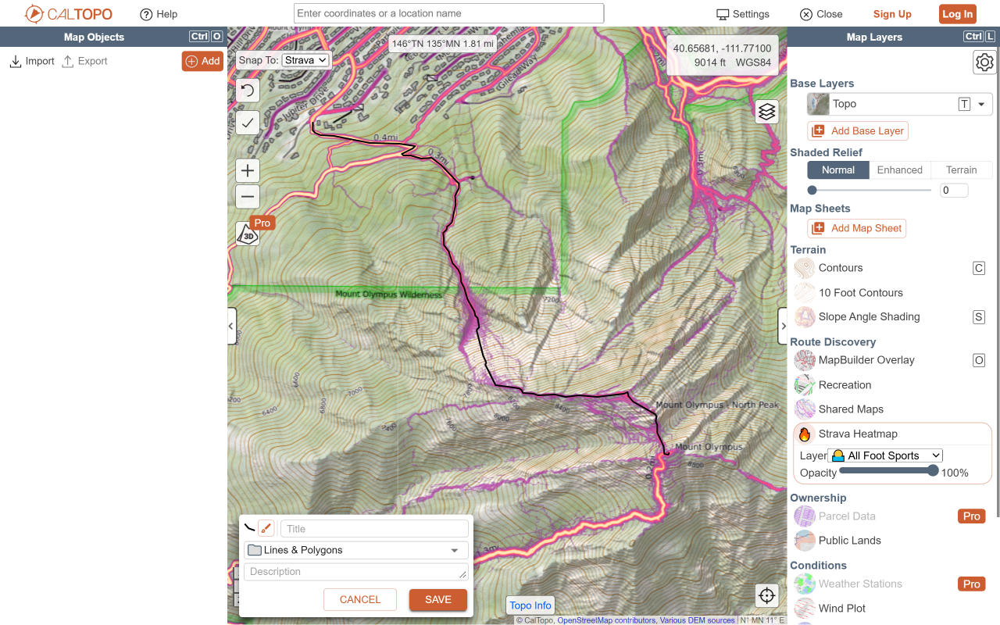

# Strava Heatmap extension

This browser extension seamlessly integrates the [Strava Global Heatmap](https://www.strava.com/maps/global-heatmap) into popular mapping editors, including the OpenStreetMap [iD editor](https://www.openstreetmap.org/edit?editor=id), [GPX Studio](https://gpx.studio/app), and [CalTopo](https://caltopo.com/), enhancing your mapping and route analysis capabilities. In iD and CalTopo, [Strava Slide](#strava-slide-id) snaps a roughly drawn line onto the heatmap trail.

&nbsp;

## Pre-requisites

### Strava account

If you don’t already have a Strava account, you’ll need to create one (free) to use the Strava Heatmap.

1. Go to https://www.strava.com/register/free
2. Sign up using Google, Apple, Facebook, or your email

## Installation

### Chrome

Open the [Chrome extension page](https://chromewebstore.google.com/detail/strava-heatmap-for-caltop/onkfebhamefccjmidebejlgngenfeoai) for the extension.

1. Click `Add to Chrome`.
2. Confirm permissions by selecting `Add extension`.
3. Chrome will briefly display a popup and show the new extension icon in the top-right toolbar.
4. Right-click the extension icon and choose `Pin` to keep it visible.
5. Alternatively, open the puzzle-piece Extensions menu and click the 📌 next to Strava Heatmap extension.

### Firefox

Requires Firefox 140 or later on desktop, or Firefox 142 or later on Android.
Firefox requests consent to transmit Strava authentication information and map
tile coordinates for heatmap access. See the [privacy policy](PRIVACY.md).

Open the [Firefox add-on](https://addons.mozilla.org/en-US/firefox/addon/strava-heatmap-for-caltopo) for the extension.

1. Click `Add to Firefox`.
2. Confirm permissions by selecting `Add`.
3. Firefox will briefly display a popup and show the new extension icon in the top-right toolbar.
4. Make sure `Pin extension to toolbar` is selected and click `OK`.
5. Alternatively, right-click the extension icon and choose `Pin` to keep it visible.

### Other browsers

The extension hasn't been tested or fully supported on other Chromium-based browsers like Brave and Opera.

### Versions

See the [Changelog](./CHANGELOG.md) for details.

### Building from source

With Node.js 20 or newer installed, run:

```sh
npm install
npm run build
```

The build works on Windows, macOS, and Linux without external shell or ZIP tools.
It creates Chrome and Firefox ZIP packages in `dist/` and an unpacked Chrome
extension in `dist/<version>-chrome/`. In Chrome's extension manager, enable
Developer mode and use **Load unpacked** to select that folder.

To build only the CalTopo integration, run:

```sh
npm run build -- --caltopo-only
```

This creates `dist/<version>-caltopo-only-chrome.zip`,
`dist/<version>-caltopo-only-firefox.zip`, and the unpacked Chrome extension in
`dist/<version>-caltopo-only-chrome/`, without replacing the full builds.
These packages omit the iD and GPX.studio integrations and their site permissions,
but retain Strava authentication, settings, and the shared snapping modules needed
by CalTopo.

### Icon artwork

The CalTopo fork's source icon is [icons/icon.svg](./icons/icon.svg): a flaming
compass designed for 48 x 48 and 128 x 128 pixels, in color or grayscale.
It is a self-contained SVG with a transparent background and no external fonts
or images. After editing the SVG, regenerate all four PNG icons with:

```sh
npm run icons
```

This replaces `icons/icon-48.png`, `icons/icon-128.png`, and their
`-grayscale.png` variants, preserving transparency. It uses Sharp on Windows,
macOS, and Linux without external image tools. PNG generation is separate from
`npm run build`; regenerate and commit the icons when the source artwork changes.

### Store promotional image

[images/promo-small.png](./images/promo-small.png) is the store's 440 x 280
small promo tile: a 24-bit RGB PNG without alpha. It pairs the source icon with
original illustrated contours and heatmap trails, not copied map imagery.

Run `npm run promo` to regenerate the PNG and its self-contained
[SVG](./images/promo-small.svg) from [scripts/promo.js](./scripts/promo.js)
and the current source icon. The SVG is also suitable for editing in a vector
editor; regeneration replaces both outputs.

### Instructions

## OpenStreetMap iD editor

To enable the Strava Heatmap in the iD editor:

1. Open the iD editor: https://www.openstreetmap.org/edit?editor=id
2. Press B or click Background settings, then scroll to Overlays.
3. Select a Strava Heatmap overlay from the list.
4. If you see the message "Click the Strava Heatmap extension icon to log into Strava…", click the red extension icon to authenticate.
5. After logging in, use the extension icon to configure heatmap layers: choose activity type and color, and manage layer order or deletion.
6. In the editor, press Shift + Q to toggle all overlays (including the heatmap), and Shift + W to toggle data visibility.

### Strava Slide (iD)

https://github.com/user-attachments/assets/0b53814f-94b8-4ed1-9380-0b048f3b9e37

With a Strava Heatmap overlay switched on and the extension signed in, an existing line can be snapped to the closest trace of that heatmap. Inspired by [Paul Mach's Slide](https://github.com/paulmach/slide/) and [Strava's iD integration](https://github.com/strava/iD).

1. Log into Strava with the extension and enable a Strava heatmap overlay.
2. Draw a rough line along the trail, or select an existing line. It can start and end on other roads or paths: those junctions stay in place, and the line is traced into them.
3. Press **Shift + S** (also right after drawing), or right-click the selected line and choose **Slide**.
   To slide only part of a way, select two or more of its points instead.
4. If several Strava overlays are enabled, choose the activity to follow.
5. Review the result before saving. Use iD's normal **Undo** to restore the original line.

What Slide changes:

- The line's first and last points, junctions with other ways, tagged nodes (fords, gates, crossings…) and relation members stay in place: to move one, disconnect it or move it by hand first.
- Where the line meets another road or path, it does not run along it. The heat of other mapped roads and paths is ignored, so a stronger parallel trail does not pull the line onto it.
- Sections with no usable heatmap trail are left as drawn, and the rest is slid. A message tells you how many.
- Near-duplicate points, tiny kinks and spikes are removed. Only untagged nodes not used by anything else are ever deleted.
- Bridges and tunnels themselves are not slid.

#### Known issues

Feedback and test cases are collected in [#43](https://github.com/julcnx/strava-heatmap-extension/issues/43). Always review the result before saving.

- **Parallel trails:** the heat within a few metres of other mapped roads and paths is ignored, and a section that would detour onto another heat trace is left as drawn. A point drawn closer to a stronger trail than to its own can still snap onto it. Workaround: Undo and slide only the sections around it (select two points: the selected end points stay in place), then fix that part by hand. Next step: snap to the closest trail rather than the strongest.
- **Tight switchbacks:** where the legs of a tight switchback merge into one band of heat, Slide cannot see the tip and cuts it short. Workaround: slide the line up to the switchback and from it (select two points), or move the tip by hand. Next step (v0.16.0): keep drawn tips where the heat cannot show them.
- **"Slide needs too many tiles":** the box around the line must fit in 16 heatmap tiles (about 4 × 4 km, less at high latitudes), so long or diagonal lines are refused. Workaround: select two points and slide the line in sections. Next step (v0.16.0): split long lines into sections automatically, with one Undo.

The extension's shortcuts are also listed in iD's keyboard shortcuts panel (**?**).

### GPX.studio editor

To enable the Strava Heatmap in GPX.studio:

1. Open GPX.studio: https://gpx.studio/app
2. Hover over the layers menu icon, then scroll to Overlays.
3. Choose a Strava Heatmap overlay from the list.
4. If you see the message "Click the Strava Heatmap extension icon to log into Strava…", click the red extension icon to authenticate.
5. Once logged in, use the green extension icon to configure, reorder, or delete heatmap layers by activity and color.

### CalTopo

To enable the Strava Heatmap in CalTopo:

1. Open a map at https://caltopo.com/.
2. In the Map Layers panel to the right of the map, under "Route Discovery", toggle the Strava Heatmap layer. Select a configured layer, toggle it, or adjust its opacity.
3. Use the extension icon to log into Strava and configure the available heatmap layers.

The live overlay is not shown in CalTopo's print preview because PDFs are rendered
server-side and cannot include it. To include a heatmap in a printed map, first
[save it as a map sheet](#save-a-caltopo-heatmap-map-sheet).

#### Snap drawing segments to Strava

1. Sign into Strava using the extension and select the activity layer in the Strava heatmap controls.
2. Choose **Add > Line**, **Polygon**, or **Buffer** (and enter its radius), then select **Strava** in the map's **Snap To** dropdown. The measure tool also supports Strava snapping.
3. Zoom to `z=15` or higher, then **click anywhere to begin**. Strava suggests paths from that exact point, shown in semitransparent yellow. A hovered option becomes wider and brighter and previews the path up to your cursor; click to confirm that draft.
   Click away from the highlighted options to add a straight segment, just as with CalTopo's other snap sources. Every confirmed point generates a fresh set of suggestions.
4. Use CalTopo's normal **Undo** (or **Esc**) to remove a segment, and finish or save normally. CalTopo still handles polygon closing and buffer geometry. To snap a polygon's final edge too, click back on its starting point before finishing.
   Double-click to finish.

Snapping uses the selected Strava activity and palette, even if the overlay is hidden.
Suggestions use Slide's locally normalized intensity surface and least-cost
pathfinding, rather than skeletonizing heat-band outlines. One shared search
finds paths toward 48 targets on a 7-by-7 grid centered on the anchor, excluding
the center. The grid spans 1 km east-west and north-south, with targets about
167 m apart. Sampling is independent of map zoom and uses the same unbiased
grid at every anchor, regardless of the previous drawing direction.
Sample endpoints can move onto nearby heat; clicked anchors remain exact.

Paths fully contained in a longer path are removed. Paths sharing at least
90% of **both** trajectories (within one `z=15` heatmap
pixel) merge into a common trunk ending at their branching point. Choosing that
point generates new options for the branches. Deduplication repeats after
truncation to remove newly redundant trunks. All remaining options are shown,
ordered by Slide cost per metre, not total cost.
Selected paths then use Slide's heat-guarded smoothing to remove pixel-grid
zigzags, with clicked anchors and branch points held in place. Smoothing backs
off at tight bends rather than leaving the heat ridge or crossing missing
imagery.

These are suggestions from heatmap imagery, not mapped trail data. Missing
coverage and long dark gaps are rejected; a short off-heat approach from a
clicked anchor is allowed. Always review the draft, especially at forks.
Missing tiles or expired login shows an error beside **Snap To** without
preventing straight drawing. Zoom in, click off the options to draw across a
gap, or choose **OSM** for mapped-trail routing.

### Save a CalTopo heatmap map sheet

With a CalTopo Pro account and the extension signed into Strava, choose your
activity and color in the Strava Heatmap layer controls. Open **Add > Map Sheet
from Strava Heatmap**, directly below **Map Sheet**, at any map zoom level.
The selection form sits at the bottom left of the map. Finish or cancel any
other item you are creating first; CalTopo allows only one new item at a time,
including heatmap map sheets.
A square of zoom-15 tiles starts centered on your map view, using the largest
whole-tile square that fits with room for its handles, from 1-by-1 up to 10-by-10.
If a single tile exceeds the view, zoom out to see all its handles. Drag its edge or
corner handles to resize it around the area you want. The **Sheet name** field suggests
a name containing the activity, color, and UTC date; keep it or enter your own
non-empty name, then choose **Capture**.
The box stops growing before it would include more than 100 tiles at
zoom 15. A live tile count shows the selection size. Use CalTopo's
normal map controls to pan and zoom without changing the selected geographic
area. Only the resize handles intercept dragging; the map remains draggable
inside and outside the box.
Choose **Cancel** or press **Escape** to exit without downloading or uploading.

After confirmation, the extension stitches the full tiles intersecting your box,
applies the selected color (independent of the overlay opacity), and uploads and aligns the
image automatically. It saves the sheet privately to your CalTopo account and
adds it to the current map using your chosen name. **Share publicly is always
off.** Account map sheets can be used on mobile,
downloaded there, and included in printed PDFs using CalTopo's normal controls.

You can cancel while tiles are being prepared. Once uploading starts, wait for
the result. If a request times out, check your account before retrying to avoid
duplicates. If the current map cannot be edited, the account copy remains
available through **Map Sheet > From Account**. Views crossing the date line or
extending outside Web Mercator's latitude limits must be repositioned first.

### Troubleshooting

#### Blank or incomplete heatmap at low zoom levels

Strava's tile service has known low-zoom issues:

- **Tile zoom 0:** Strava returns a fully black image for `0/0/0`, with no heatmap data. The effective minimum tile zoom is therefore **1**.
- **Tile zoom 1:** All four tiles are requested, but Strava returns incomplete global coverage. Parts of Norway, South Africa, and the Pacific show heat, while North America and most of Europe do not.

These are upstream Strava issues, not CalTopo-specific rendering problems. They
also affect the other clients in the main fork. Zoom in further to view more
local heatmap data.

The zoom levels above refer to Strava tile URLs (`{z}/{x}/{y}`); a client's
displayed map zoom may differ if it uses a tile zoom offset. CalTopo uses
256-pixel display tiles with no offset, so its map and tile zoom levels match.

**Q: “Click the Strava Heatmap extension icon to log into Strava and enable the heatmap.” — What does this mean?**  
**A:** This message appears if you're not logged in to Strava AND haven’t visited the [Strava Global Heatmap](https://www.strava.com/heatmap). Just click the extension icon to sign in and authorize access.

### Feature and Bug Requests

Submit issues and feature requests in the [Issues](https://github.com/tjasz/strava-heatmap-extension/issues) section above.

## Extension Background

Previously, accessing Strava heatmap in OpenStreetMap iD editor required a tedious process of extracting Strava website cookies and generating a temporary URL that would expire after a week.

The [JOSM Strava Heatmap Extension](https://github.com/zekefarwell/josm-strava-heatmap) simplified this process, but due to the lack of support for custom overlays in the iD editor, users could only add the URL as a custom background.

With this extension, you can now automatically access all Strava activities as Heatmap overlays, eliminating the need for manual URL management.

To learn more about using the Strava Heatmap in OpenStreetMap, visit the [Strava wiki](https://wiki.openstreetmap.org/wiki/Strava).

### Support for Other Sites

This extension currently supports the iD editor, [gpx.studio](https://gpx.studio), and [CalTopo](https://caltopo.com/). I'm not taking on additional sites at the moment. If you'd like to add support for another tool, feel free to fork the project.

- For JOSM, check out the [JOSM Strava Heatmap Extension](https://github.com/zekefarwell/josm-strava-heatmap).
- For RapidId, refer to the [RapId Power User Extension](https://github.com/emersonveenstra/rapid-power-user-extension/).
