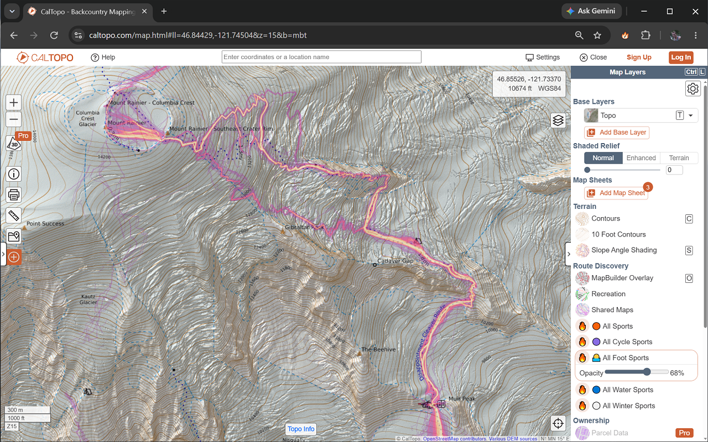
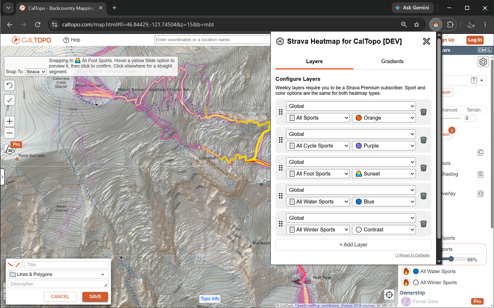
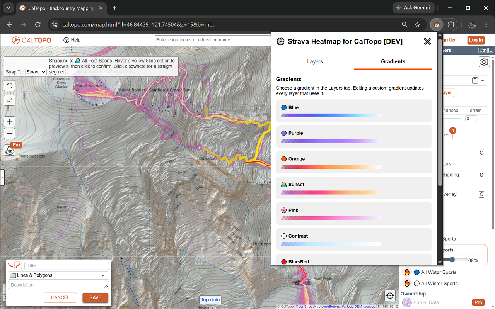
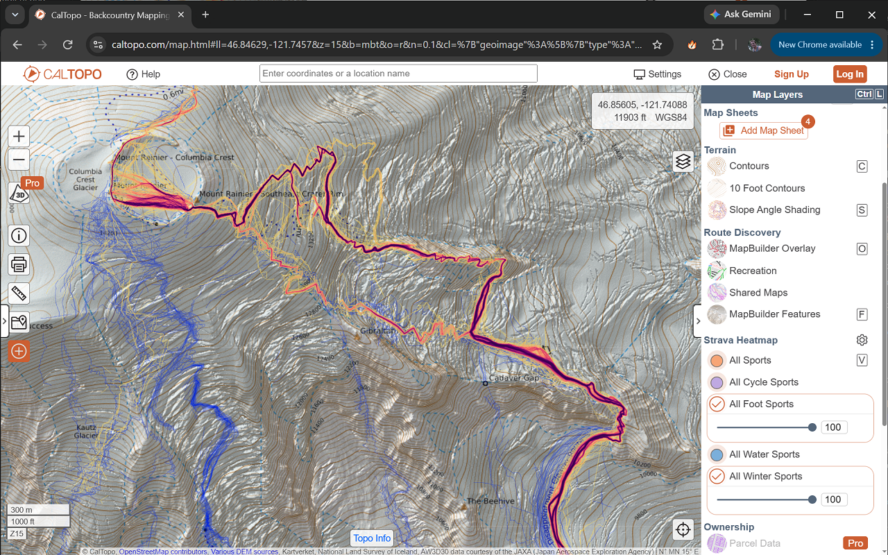
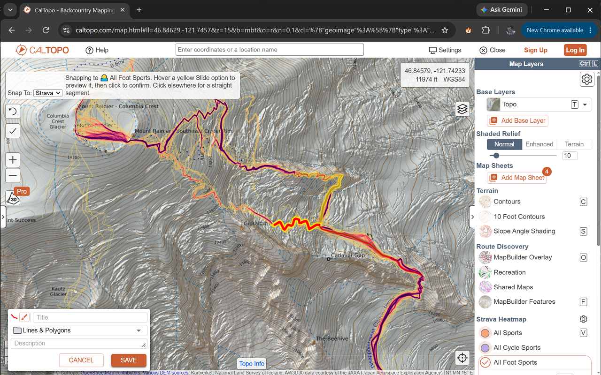

# Strava Heatmap for CalTopo

This guide covers using the Strava Heatmap extension in [CalTopo](https://caltopo.com/) to display heatmap layers and draw along heatmap paths.

## Requirements

- A free [Strava account](https://www.strava.com/register/free) for Global heatmaps. You can sign up with Google, Apple, Facebook, or email.
- A Strava Premium subscription for access to Weekly heatmaps. The extension does not unlock subscription-only data.
- A supported browser:
  - Chrome
  - Edge
  - Firefox 140 or later
  - Firefox 142 or later on Android

Other Chromium-based browsers, such as Brave and Opera, have not been tested.

## Install the extension

### Chrome/Edge

1. Open the [Chrome extension page](https://chromewebstore.google.com/detail/strava-heatmap-for-caltop/onkfebhamefccjmidebejlgngenfeoai) (works for both Chrome and Edge).
2. Click **Add to Chrome**, then **Add extension** to confirm permissions.
3. Pin the extension so you can easily access its sign-in and settings controls: open the puzzle-piece Extensions menu and click the pin next to Strava Heatmap, or right-click its icon and choose **Pin**.

### Firefox

1. Open the [Firefox add-on page](https://addons.mozilla.org/en-US/firefox/addon/strava-heatmap-for-caltopo).
2. Click **Add to Firefox**, then **Add** to confirm permissions.
3. Leave **Pin extension to toolbar** selected and click **OK**, or right-click the extension icon and choose **Pin**.

Firefox requests consent to transmit Strava authentication information and map tile coordinates for heatmap access. See the [privacy policy](../../PRIVACY.md).

## Sign in and configure heatmap layers

1. Click the extension icon to sign into Strava and authorize heatmap access.
2. Click the extension icon again to open the layer settings.
3. In the **Layers** tab, choose **Global** (the default) or **Weekly (Premium)** for each layer.
4. Choose the sport and color, then click **Apply changes**.

You can configure multiple layers for the same sport, including layers of the same heatmap type with different colors. Use the extension settings to manage the available layers.

The **Gradients** tab shows every built-in palette with a 256-by-10-pixel preview,
name, and emoji. Click **Add Gradient** to define a custom palette: enter its name
and emoji, then edit, add, remove, and reorder color and opacity stops. The preview
remains visible while editing and updates when stops change. **Done**
returns to its preview; **Edit** reopens the controls. Choose the named palette
from a layer's color dropdown and click **Apply changes** to save.
You may have to refresh open CalTopo tabs to get the updated configuration.

Custom palettes work with both Global and Weekly layers. Editing a palette updates
every layer using it. Existing saved per-layer gradients are preserved as separate
custom palettes. Resetting layers to defaults leaves your custom palettes intact.

## Show heatmaps in CalTopo

1. Open a map at [caltopo.com](https://caltopo.com/).
2. In the **Map Layers** panel to the right of the map, find **Route Discovery**. Each configured Strava heatmap has its own button.
3. Toggle any combination of layers. Each enabled layer expands to show its own opacity slider.

Each layer's visibility and opacity are saved separately. Most recently enabled layers appear on top. To bring a layer to the top, turn it off and on again; adjusting opacity does not change its stacking order. The stacking order is saved with the layer settings.

The live overlay does **not** appear in CalTopo's print preview: PDFs are rendered server-side and cannot include it.

## Snap drawing segments to Strava

Strava snapping suggests continuations along heatmap trails as you draw. These suggestions come from heatmap imagery, not mapped trail data, so always review them before saving, especially at forks.

1. Sign into Strava using the extension and select the activity layer in the Strava heatmap controls.
2. Choose **Add > Line**, **Polygon**, or **Buffer** (and enter its radius), then choose **Strava** in the map's **Snap To** dropdown. The measure tool also supports Strava snapping.
3. Zoom to **z=15 or higher**, then click anywhere to begin. Your clicked starting point remains exact.
4. Suggested paths appear in semitransparent yellow. Hover over an option to make it wider and brighter and preview the path up to your cursor. Click to confirm that draft.
5. Every confirmed point generates fresh suggestions. Click away from highlighted options to add a straight segment, just as with CalTopo's other snap sources.
6. Use CalTopo's normal **Undo** or **Esc** to remove a segment. Double-click to finish, and save normally.

CalTopo still handles polygon closing and buffer geometry. To snap a polygon's final edge too, click back on its starting point before finishing.

### Which layer does snapping use?

Snapping uses the topmost enabled Strava layer: the one you most recently enabled. Adjusting opacity does not change the snapping layer. Hiding the top layer switches snapping to the next enabled layer below it. If only one layer is enabled, snapping always uses it. If all layers are hidden, suggestions disappear and the status asks you to enable a heatmap layer; you can still draw straight segments. The status beside **Snap To** names the layer currently used.

### What to expect from suggestions

- Suggestions search roughly 1 km east-west and north-south around each confirmed point, independent of map zoom or the previous drawing direction.
- Shared paths are combined into trunks ending at branching points. Choose a branching point to generate new options for the branches.
- Paths are smoothed to remove pixel-grid zigzags while keeping clicked anchors and branch points in place. Suggested endpoints may move onto nearby heat.
- Missing coverage and long dark gaps are rejected. A short off-heat approach from a clicked anchor is allowed.

If suggestions cannot cross a gap, click off the options to draw a straight segment, or choose **OSM** for mapped-trail routing. Missing tiles or expired login show an error beside **Snap To** without preventing straight drawing. Check your sign-in and zoom level when suggestions are unavailable.

## Troubleshooting

### The extension asks me to sign into Strava

If you see "Click the Strava Heatmap extension icon to log into Strava and enable the heatmap," click the extension icon to sign in and authorize access. This message appears when you are not logged into Strava and have not visited the [Strava Global Heatmap](https://www.strava.com/heatmap).

### The heatmap is blank or incomplete when zoomed far out

Strava's tile service has known low-zoom issues:

- **Zoom 0:** Strava returns a fully black image with no heatmap data. The effective minimum tile zoom is **1**.
- **Zoom 1:** Strava returns incomplete global coverage. Parts of Norway, South Africa, and the Pacific show heat, while North America and most of Europe do not.

These are upstream Strava issues, not CalTopo rendering problems. Zoom in further to view local heatmap data. CalTopo's map and Strava tile zoom levels match because CalTopo uses 256-pixel display tiles with no zoom offset.

### The heatmap is missing from print preview

The live overlay cannot be included in server-rendered PDFs.

## Updates and feedback

- Submit bugs and feature requests through [GitHub Issues](https://github.com/tjasz/strava-heatmap-extension/issues).
- See the [changelog](../../CHANGELOG.md) for version details.
